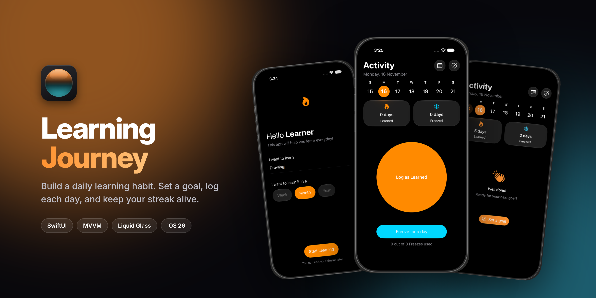
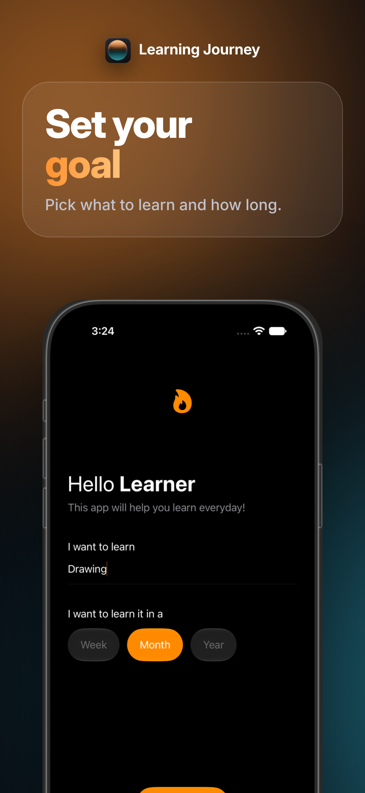
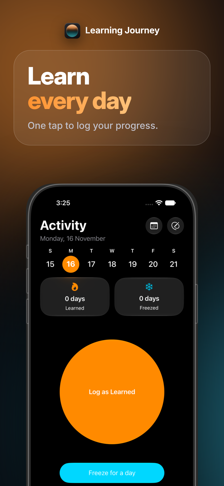
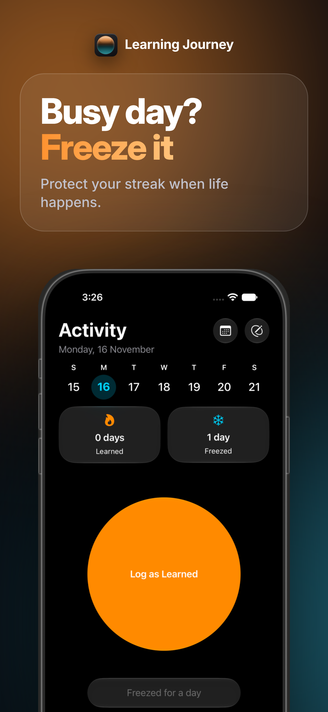
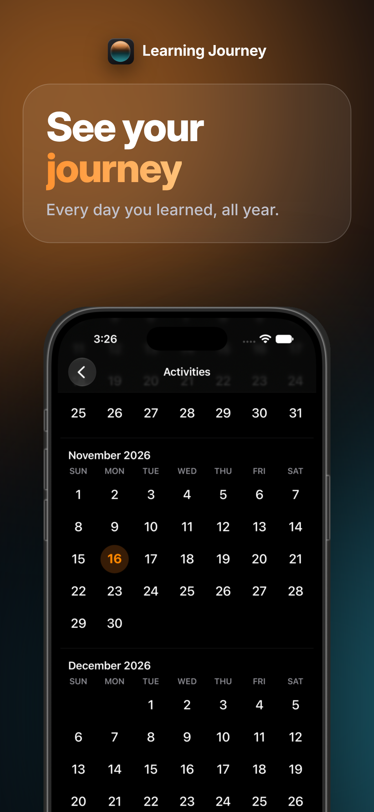
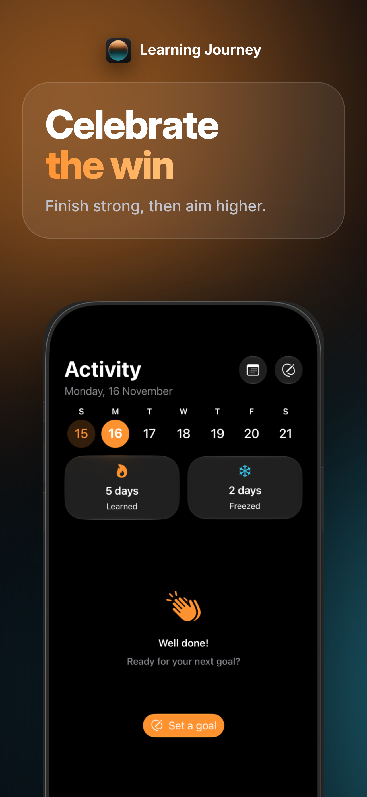

# 🔥 Learning Journey



A SwiftUI app that helps learners build a daily learning habit. Set a goal, log each day you learn, and keep your streak alive.

Built in 10 days with a focus on clean architecture, data modeling, and Liquid Glass.

## ✨ Features

- **Set a learning goal** with a subject and a duration (week, month, or year)
- **Log a day as learned** or **freeze a day** to protect your streak
- **Undo or switch** today's log between learned and frozen
- **Track your progress** with learned and frozen day counters
- **See your week** at a glance and your **full year** in the calendar
- **Edit your goal** anytime (your streak starts over)
- **Progress is saved** after closing the app

## 📏 Rules

- The streak resets after **32 hours** without logging or freezing
- Freezes are limited per goal: **2** a week, **8** a month, **96** a year
- Buttons re-enable at **12 AM**
- If the streak breaks, the goal shows **Not met** right away
- Reaching the end without breaking the streak shows **Well done!**

## 📸 Screenshots

<p align="center">
  
  
  
  
  
</p>

## 🛠 Technologies

- **SwiftUI** · iOS 26
- **MVVM** architecture with `@Observable`
- **State management:** `@State`, `@Binding`, `@Environment`
- **Navigation:** `NavigationStack`, `navigationDestination`, `NavigationLink`
- **Layout:** `VStack`, `HStack`, `LazyVGrid`, `ScrollView`, `scrollPosition`
- **Liquid Glass:** `glassEffect`, `glassProminent`, `GlassEffectContainer`
- **Persistence:** `UserDefaults` + `Codable` (JSON)
- **Dates:** `Calendar`, `Date` extensions
- **Icon Composer** for an adaptive app icon (Default, Dark, Clear)

## 🏗 Project Structure

```
LearningApp/
├── Models/        Data types (LearningGoal, DayLog, Duration…)
├── ViewModels/    App logic and rules
├── Views/         Screens and reusable components
├── Services/      Saving and loading data
└── Extensions/    Date helpers
```

## 💡 Key Decisions

- **Single source of truth.** One shared ViewModel is injected through the environment, so every screen stays in sync. Its data is `private(set)` and only changes through actions that check the rules first.
- **Logic stays out of views.** Views read ready-made values like `canFreeze` or `learnedText`, so each rule is written once.
- **Enums for fixed options.** `Duration` holds its own freeze limit, and `GoalState` prevents contradictory states.
- **History is never deleted.** Resetting the streak moves a start date instead of removing logs, so the calendar keeps the full history.
- **Native components first.** SwiftUI buttons, alerts, and toolbars bring accessibility, Dynamic Type, and Liquid Glass for free. Custom views are used only where nothing native fits, like the calendar.
- **UserDefaults over SwiftData.** The data is small and the models stay as structs. Persistence lives in a separate `StorageService`, so changing storage later touches one file.

## 🧪 Testing

- **Xcode Previews** with a `DEBUG`-only factory show the Completed and Not met states without waiting.
- **Changing the device date** tests the real logic (32-hour reset, midnight re-enable, goal result) without changing code. This revealed and fixed a bug where a streak reset granted extra freezes.

## 📚 What I Learned

- Structuring an app with **MVVM** and keeping views free of logic
- Choosing between **struct, class, and enum**, and using **Optionals** for "no data yet"
- Managing state with **@State, @Binding, @Environment, and @Observable**
- Working with **dates, Liquid Glass, and Git branches**

## 🚀 Future Improvements

- History of past goals and statistics (moving storage to **SwiftData**)
- Tap a calendar day to see its details
- Daily reminder notifications

## ▶️ Getting Started

1. Clone the repository
2. Open `Learning-App.xcodeproj` in **Xcode 26** or later
3. Run on an iPhone simulator or device with **iOS 26+**

## 📫 Contact

[LinkedIn](https://www.linkedin.com/in/hadeelawaji) · [GitHub](https://github.com/HadeelAwaji)
