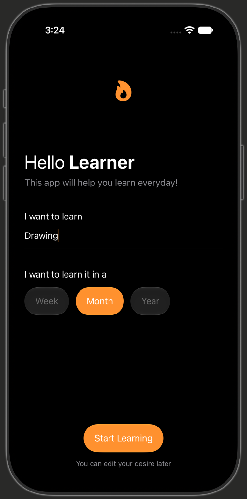
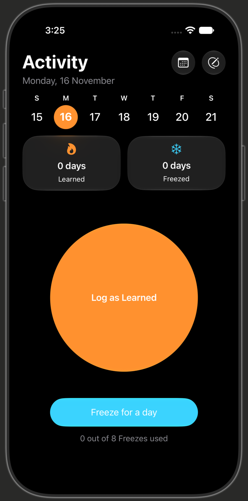
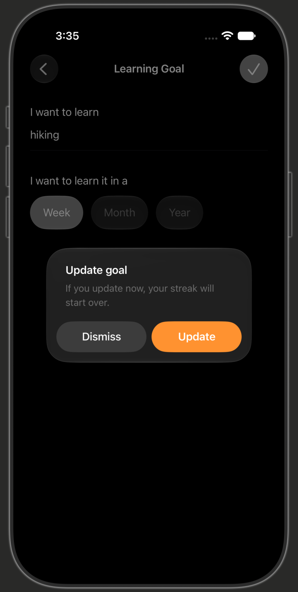
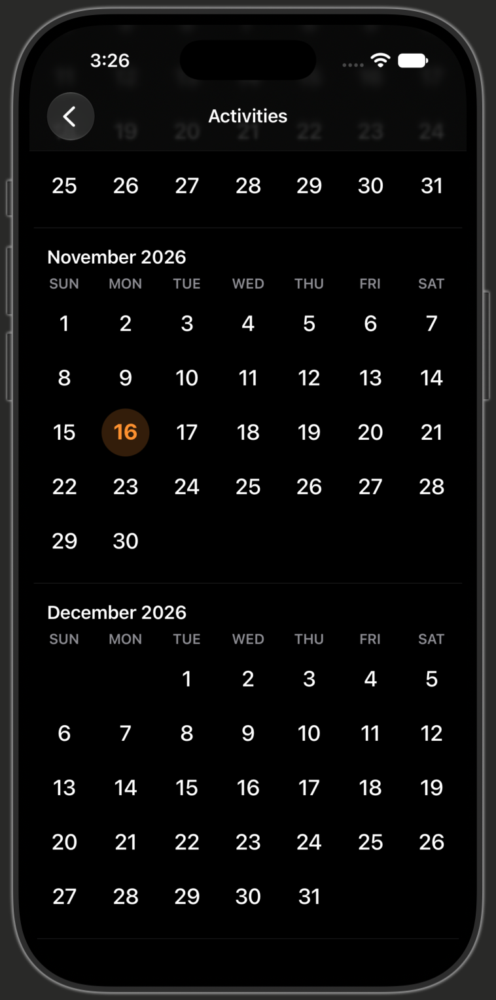
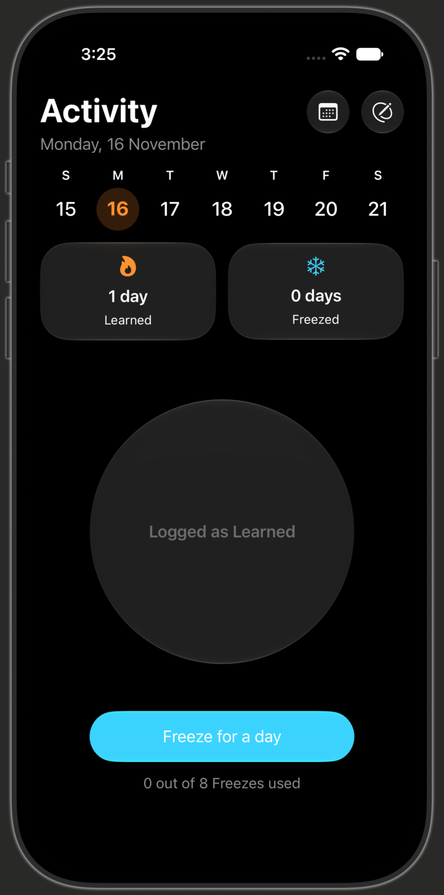
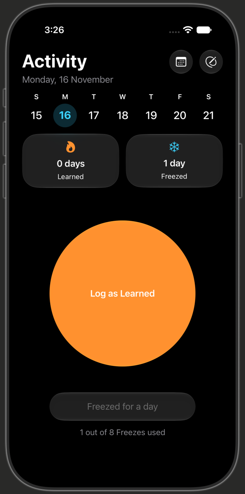
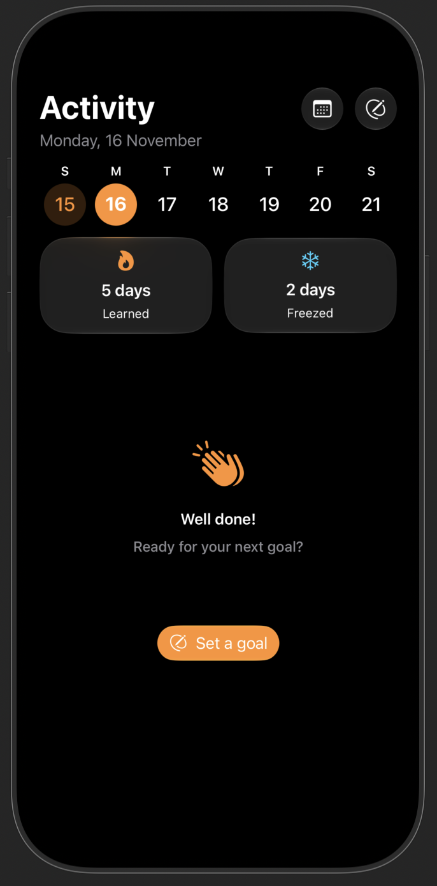
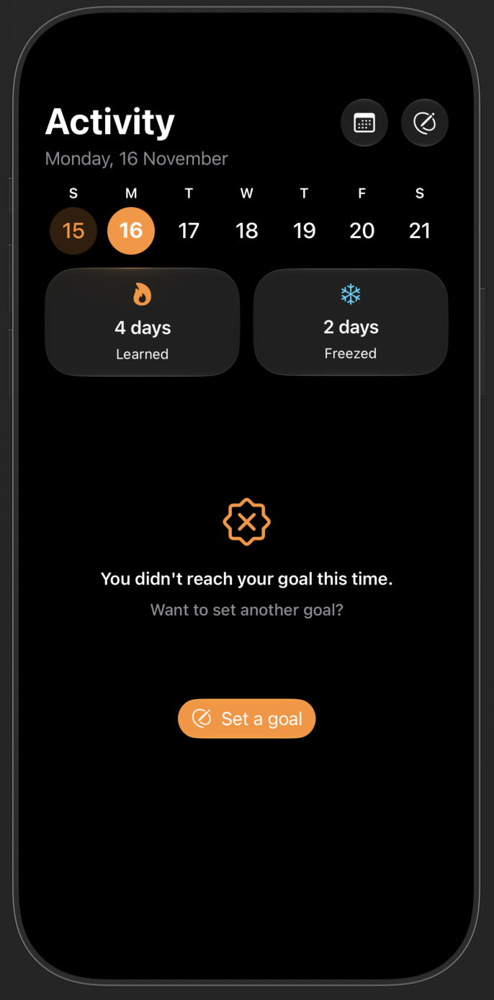

# 🔥 Learning Journey

A SwiftUI app that helps learners build a daily learning habit. Set a learning goal, log each day you learn, and keep your streak alive.

## ✨ Features

- **Set a learning goal** with a subject and a duration (week, month, or year)
- **Log a day as learned** or **freeze a day** to protect your streak
- **Undo or switch** today's log between learned and frozen
- **Track your streak** with learned and freezed day counters
- **See your week** at a glance and your **full year** in the calendar
- **Edit your goal** anytime (your streak starts over)
- **Your progress is saved** even after closing the app

## 📏 Rules

- The streak resets after **32 hours** without logging or freezing
- Freezes are limited per goal: **2** a week, **8** a month, **96** a year
- Buttons re-enable at **12 AM**
- If the streak breaks, the goal shows **Not met** right away
- Reaching the end without breaking the streak shows **Well done!**

## 📸 Screenshots

| Onboarding | Activity | Learning Goal | Calendar |
|---|---|---|---|
|  |  |  |  |

| Logged | Frozen | Well done | Not met |
|---|---|---|---|
|  |  |  |  |

## 🛠 Technologies

- **SwiftUI** · iOS 26
- **MVVM** architecture
- **Liquid Glass** (`glassEffect`, `glassProminent`)
- **UserDefaults + Codable** for saving progress
- **Icon Composer** for the app icon

## 🏗 Project Structure

```
LearningApp/
├── Models/        Data types (LearningGoal, DayLog, Duration…)
├── ViewModels/    App logic and rules
├── Views/         Screens and reusable components
├── Services/      Saving and loading data
└── Extensions/    Date helpers
```

## 🎨 Credits

UI design provided by the **Apple Developer Academy**.
Developed by **Hadeel Awaji**.
